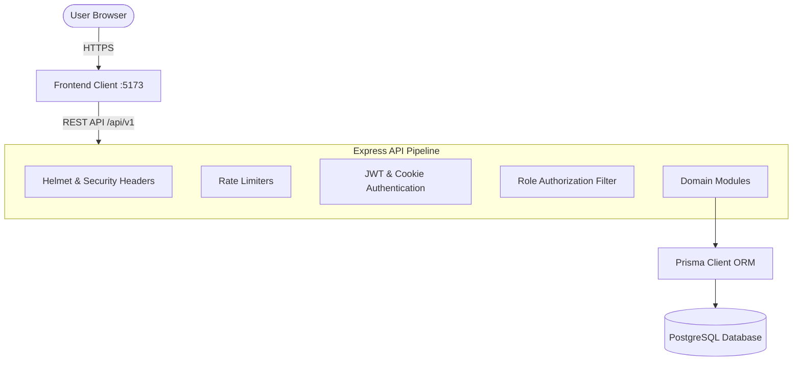
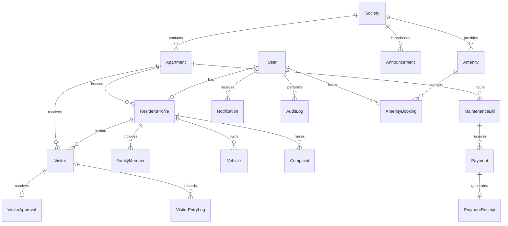

# Nivasa System Architecture & Design Specification

## 1. System Overview

Nivasa is an enterprise-grade Smart Apartment and Society Management platform designed around a decoupled, API-first architecture:

- **Frontend Client**: Single-Page Application (SPA) built using React 19, TypeScript, Vite, and Tailwind CSS.
- **Backend API**: RESTful Express service with TypeScript, Prisma ORM, and PostgreSQL.
- **Security & Authorization**: Role-Based Access Control (RBAC) supporting three primary user personas: `ADMIN`, `RESIDENT`, and `SECURITY`.

---

## 2. Role-Based Access Control (RBAC) Matrix

| Module / Resource | Endpoint Prefix | ADMIN | RESIDENT | SECURITY |
|---|---|:---:|:---:|:---:|
| **Authentication** | `/api/v1/auth` | ✅ | ✅ | ✅ |
| **User Directory** | `/api/v1/users` | Full CRUD | Self View/Edit | Read Only |
| **Apartments** | `/api/v1/apartments` | Full CRUD | View Only | View Only |
| **Residents** | `/api/v1/residents` | Full CRUD | Self Profile | Read Roster |
| **Household & Family** | `/api/v1/family-members` | Full CRUD | Self Unit Only | Read (SOS) |
| **Vehicles & Parking** | `/api/v1/vehicles` | Full CRUD | Self Unit Only | Gate Lookup |
| **Visitors & Invites** | `/api/v1/visitors` | View / Override | Pre-invite / Approve | View / Create Walk-in |
| **Gate Operations** | `/api/v1/gate` | View / Audit | ❌ | Check-in / Check-out |
| **Maintenance Invoices**| `/api/v1/maintenance` | Generate / Bulk | Self Bills Only | ❌ |
| **Payments & Receipts** | `/api/v1/payments` | Record / Receipts | Pay Online / Receipts | ❌ |
| **Complaints Helpdesk** | `/api/v1/complaints` | Assign / Resolve | Raise / Track | ❌ |
| **Amenities** | `/api/v1/amenities` | Full CRUD | View Guidelines | View Timings |
| **Facility Bookings** | `/api/v1/bookings` | Approve / Manage | Reserve / Cancel | View Scheduled |
| **Notice Board** | `/api/v1/announcements`| Post / Pin / Delete | View Published | View Published |
| **Audit Logs** | `/api/v1/reports/audit-logs`| View Log Records | ❌ | ❌ |

---

## 3. Database Entity Relationship Model

---

## 4. Key Design Decisions

### 4.1 Token Security Strategy
- **Access Tokens**: Short-lived (15 minutes), signed with `JWT_SECRET`, carried via `Authorization: Bearer <token>` or fallback header.
- **Refresh Tokens**: Long-lived (7 days), stored in secure `HttpOnly` and `SameSite: strict` cookies, signed with `JWT_REFRESH_SECRET`.
- **Axios Response Interceptor**: When access token expires (HTTP 401), client automatically sends `/auth/refresh` request and transparently replays original call.

### 4.2 Gate Clearance Workflow
1. Resident pre-invites a visitor via `/api/v1/visitors`, generating a cryptographically random pass code (e.g. `NV-XXXXXX`).
2. When the visitor arrives at the security gate, the security guard types the code into `/api/v1/gate/verify/:passCode`.
3. The guard clicks **Grant Check-in Entry** (`/api/v1/gate/checkin`).
4. System updates visitor status to `CHECKED_IN`, creates a `VisitorEntryLog`, logs an `AuditLog`, and notifies the resident.
5. On departure, guard clicks **Check Out** (`/api/v1/gate/checkout`), logging the exit timestamp.

### 4.3 Amenity Conflict Prevention
- Booking submissions (`/api/v1/bookings`) run inside a Prisma transactional query to guarantee zero double-booking on overlapping slots for any facility.
